# Pluggable Executors & Graph Introspection Guide

Strata v2 separates **what** a pipeline computes (graph topology) from **how** it runs (concurrency and observability) and **how it is inspected** (static metrics and diagram export).

---

## 1. Pluggable Executors

### Built-In Executors

| Executor | Mojo (`strata.executors`) | Python (`strata`) | Behavior |
| :--- | :--- | :--- | :--- |
| `AsyncRTExecutor` | Default (`IS_PARALLEL = True`) | Default (`pipeline(x)`) | Unbounded parallel dispatch on Mojo `TaskGroup` |
| `SequentialExecutor` | `SequentialExecutor()` | `SequentialExecutor()` | Single-threaded deterministic execution (no `TaskGroup` calls) |
| `BoundedExecutor` | `BoundedExecutor(max_workers=N)` | *(use `map_task(..., max_concurrency=N)` / `stream(..., max_in_flight=N)`)* | Parallel waves capped at `max_workers` tasks in flight |
| `TracingExecutor` | `TracingExecutor[Inner]()` | `TracingExecutor(sequential=False)` | Captures per-stage monotonic nanosecond `TraceSpan`s |

### Executing Mojo Pipelines with `run_with`

Both runtime `strata.pipeline` (borrowed & owned), `strata.pipeline.combinators`, and compile-time `strata.pipeline.compt` stages support `run_with(exec, arg)`:

```mojo
from strata.executors import (
    AsyncRTExecutor,
    BoundedExecutor,
    SequentialExecutor,
    TracingExecutor,
)
from strata.pipeline import Fn, run_with

def add_one(x: Int) -> Int: return x + 1
def mul_two(x: Int) -> Int: return x * 2
def mul_three(x: Int) -> Int: return x * 3
def sum_pair(v: Tuple[Int, Int]) -> Int: return v[0] + v[1]

def main():
    var s1 = Fn(add_one)
    var s2 = Fn(mul_two)
    var s3 = Fn(mul_three)
    var s4 = Fn(sum_pair)
    var pipe = s1 | (s2 & s3) | s4

    # 1. Deterministic single-threaded execution (ideal for debugging/baselines)
    var seq = SequentialExecutor()
    print(run_with(seq, pipe, 4))  # 25

    # 2. Wave-bounded concurrency (at most 2 parallel branches in flight at once)
    var bounded = BoundedExecutor(max_workers=2)
    print(pipe.run_with(bounded, 4))  # 25

    # 3. Parallel tracing with lock-free per-branch timestamp capture
    var tracer = TracingExecutor()  # wraps AsyncRTExecutor by default
    print(pipe.run_with(tracer, 4))
    print(tracer.format_report())
    print("Total stage time (ns):", tracer.total_duration_ns())
    tracer.clear()

    # 4. Compose TracingExecutor around SequentialExecutor or BoundedExecutor
    var seq_tracer = TracingExecutor(SequentialExecutor())
    _ = pipe.run_with(seq_tracer, 4)

    var bounded_tracer = TracingExecutor(BoundedExecutor(2))
    _ = pipe.run_with(bounded_tracer, 4)
```

For compile-time `strata.pipeline.compt` pipelines, call `graph.run_with(exec, val)` directly — stage spans are automatically labeled with the real Mojo function names via `std.reflection.get_function_name`:

```mojo
from strata.executors import TracingExecutor
from strata.pipeline.compt import F

def step_a(x: Int) -> Int: return x + 1
def step_b(x: Int) -> Int: return x * 2

comptime pipe = F[step_a] | F[step_b]

def main():
    var tracer = TracingExecutor()
    var out = pipe.run_with(tracer, 10)  # 22
    print(tracer.format_report())
```

### Writing a Custom Mojo `Executor`

Implement the `Executor` trait in `strata.executors` to build custom telemetry, logging, or concurrency policies:

```mojo
from strata.executors import Executor

struct CountingExecutor(Executor, Movable):
    comptime IS_PARALLEL: Bool = False
    comptime IS_TRACING: Bool = False  # default; set True to enable compile-time tracing paths
    comptime IS_BOUNDED: Bool = False  # default; set True if concurrency_limit() bounds waves
    var stages_run: Int

    def __init__(out self):
        self.stages_run = 0

    def concurrency_limit(self) -> Int:
        return 1

    def is_tracing(self) -> Bool:
        return False

    def on_stage_start(mut self, name: StaticString) -> Int:
        self.stages_run += 1
        return 0

    def on_stage_end(mut self, name: StaticString, token: Int):
        pass

    def record_span(mut self, name: StaticString, start_ns: Int, end_ns: Int):
        self.stages_run += 1
```

### Python Executors (`SequentialExecutor`, `TracingExecutor`)

```python
from strata import SequentialExecutor, TracingExecutor, spread, task

@task
def double(x: int) -> int:
    return x * 2

@task
def add_ten(x: int) -> int:
    return x + 10

@spread
def add_pair(a: int, b: int) -> int:
    return a + b

pipeline = (double & add_ten) | add_pair

# Deterministic sequential baseline
seq = SequentialExecutor()
assert seq.run(pipeline, 5) == 25

# Parallel instrumented execution (sequential=False uses Mojo TaskGroup)
tracer = TracingExecutor(sequential=False)
assert tracer.run(pipeline, 5) == 25
print(tracer.format_report())
for span in tracer.spans:
    print(span.stage, span.duration_ns)
tracer.clear()
```

---

## 2. Graph Introspection & Visualization

### Compile-Time Introspection in Mojo (`strata.pipeline.compt`)

Every `strata.pipeline.compt` pipeline exposes zero-cost compile-time topology constants and diagram exporters:

- `STAGE_COUNT`: Total number of leaf stages in the graph.
- `MAX_PARALLEL_WIDTH`: Maximum simultaneous parallel branch width.
- `CRITICAL_DEPTH`: Longest sequential path length (in leaf stages).
- `to_mermaid()`: Renders a `flowchart LR` Mermaid diagram with `subgraph` blocks for explicit `group(...)` wrappers.
- `to_dot()`: Renders a Graphviz `digraph Strata` with `subgraph cluster_*` blocks for `group(...)`.

```mojo
from strata.pipeline.compt import F, Spread2, group

def parse(x: Int) -> Int: return x + 1
def left(x: Int) -> Int: return x * 2
def right(x: Int) -> Int: return x * 3
def merge(a: Int, b: Int) -> Int: return a + b

comptime diamond = F[parse] | (F[left] & F[right]) | Spread2[merge]

def main():
    comptime assert diamond.STAGE_COUNT == 4
    comptime assert diamond.MAX_PARALLEL_WIDTH == 2
    comptime assert diamond.CRITICAL_DEPTH == 3

    print(diamond.to_mermaid())
    print(diamond.to_dot())
```

Sample Mermaid output:

```mermaid
flowchart LR
  n0["parse (SIMD[DType.int, 1&#93; -> SIMD[DType.int, 1&#93;)"]
  n1["left (SIMD[DType.int, 1&#93; -> SIMD[DType.int, 1&#93;)"]
  n0 --> n1
  n2["right (SIMD[DType.int, 1&#93; -> SIMD[DType.int, 1&#93;)"]
  n0 --> n2
  n3["_spread2_fn (std.builtin.tuple.Tuple[<unprintable>, {}&#93; -> SIMD[DType.int, 1&#93;)"]
  n1 --> n3
  n2 --> n3
```


### Runtime Introspection in Python (`stats`, `to_mermaid`, `to_dot`)

Every composed Python pipeline (`_BaseTaskGroup`) exposes `.stats()`, `.to_mermaid(direction="LR")`, and `.to_dot(name="Strata", direction="LR")`, and standalone functions `graph_stats(stage)`, `to_mermaid(stage)`, and `to_dot(stage)` work on any stage or combinator:

```python
from strata import group, native_int_linear, spread, task

@task
def parse(s: str) -> int:
    return int(s)

scale = native_int_linear(scale=2, bias=1, name="scale")
shift = native_int_linear(scale=1, bias=10, name="shift")

@spread
def merge(a: int, b: int) -> int:
    return a + b

pipeline = parse | (scale & shift) | merge

stats = pipeline.stats()
# GraphStats(stage_count=4, max_parallel_width=2, critical_depth=3)

print(pipeline.to_mermaid(direction="TD"))
print(pipeline.to_dot(name="MyPipeline", direction="LR"))
```

Explicit `group(...)` wrappers render as visual `subgraph` (Mermaid) and `subgraph cluster_*` (Graphviz DOT) containers, and `NativeTask` / `AsyncTask` stages are automatically labeled `native(<name>)` and `async(<name>)`.

---

## Behavioral Notes

- **`BoundedExecutor` (Mojo)**: `max_workers <= 0` clamps to `1` (sequential execution); `max_workers > branch_count` runs all branches in a single wave.
- **`TracingExecutor` (Mojo & Python)**: Accumulates `TraceSpan`s across runs until `.clear()` is called, and composes around `AsyncRTExecutor`, `SequentialExecutor`, or `BoundedExecutor`. In Python, both `SequentialExecutor` and `TracingExecutor` also traverse nested combinators (`map_task`, `branch`, `retry`, `fallback`, `timeout`, `zip_tasks`, `group`).
- **Topology metrics & diagram escaping**: `MAX_PARALLEL_WIDTH` sums across `&` and takes `max` across `|`; `CRITICAL_DEPTH` sums across `|` and takes `max` across `&`. Special characters in stage names are escaped automatically in `to_mermaid()` and `to_dot()`, and invalid `direction` strings in Python raise `ValueError`.

For internal executor specialization and lock-free span recording details, see [DESIGN.md](../DESIGN.md).

